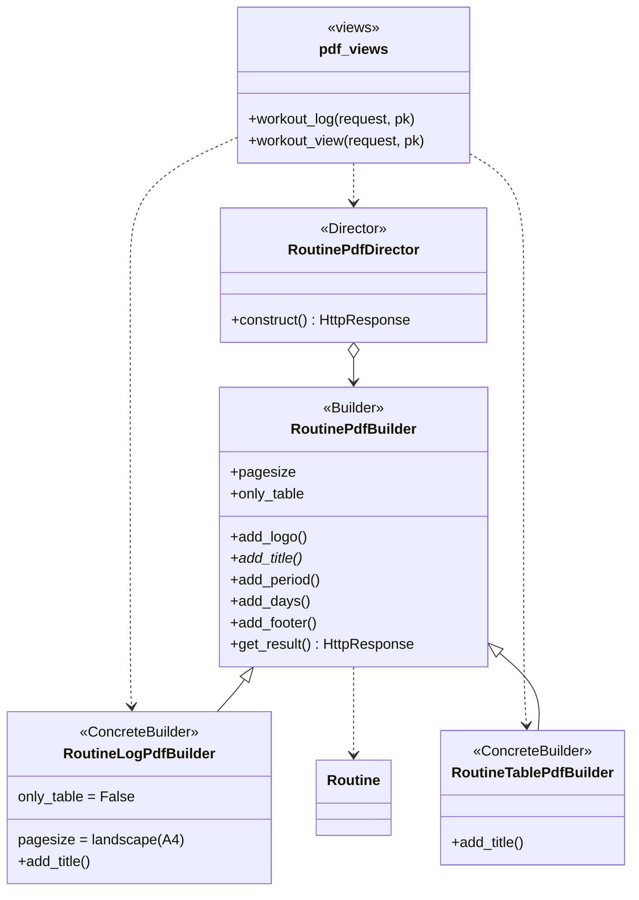
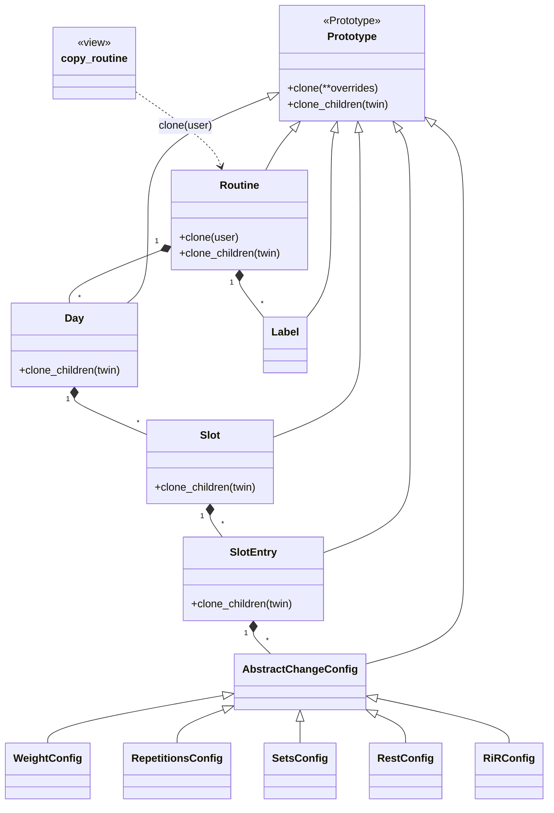

# Padrões de projeto aplicados

Os dois padrões estão no módulo de **Treinamento** (`wger/manager`), que é o núcleo do recorte.
Escolhemos esses trechos porque são casos de uso da Parte 1 (CU07 Gerar relatório PDF e CU01
Copiar rotina), têm um problema de projeto visível no código original e dá para demonstrar o
resultado no sistema rodando.

---

## 1. Builder (GoF, criacional): PDF da rotina (CU07)

### O padrão
O Builder **separa a construção de um objeto complexo da sua representação**, de modo que o
mesmo processo de construção gere representações diferentes. Os papéis são:

* **Builder**: declara os passos de construção.
* **ConcreteBuilder**: implementa os passos para uma representação específica.
* **Director**: define a ordem dos passos.
* **Product**: o objeto montado.

**Consequências.** Positivas: o processo de montagem é reutilizado, a duplicação some e cada
variação fica isolada no seu builder. Negativa: o sistema passa a ter mais classes.

### O problema no sistema (ANTES: `wger-fork/wger/manager/views/pdf.py`)
`workout_log` e `workout_view` são duas funções de ~70 linhas quase idênticas. Cada uma cria o
`HttpResponse`, configura o `SimpleDocTemplate` do reportlab, adiciona logo, título, um bloco
por dia e rodapé. Elas só diferem em três pontos: tamanho da página, título com ou sem
descrição, e tabela com ou sem colunas de registro.

```python
def workout_log(request, pk):
    ...
    response = HttpResponse(content_type='application/pdf')
    doc = SimpleDocTemplate(response, pagesize=landscape(A4), leftMargin=cm, ...)
    elements = []
    elements.append(get_logo())
    elements.append(Spacer(10 * cm, 0.5 * cm))
    p = Paragraph(f'<para align="center"><strong>{escape(routine.name)}</strong></para>', ...)
    ...
    for day_data in routine.data_for_iteration():
        ...
        elements.append(render_workout_day(day_data))
    elements.append(render_footer(...))
    doc.build(elements)
    ...

def workout_view(request, pk):
    # o mesmo código de novo, com pagesize=A4 e only_table=True
```

Uma mudança no layout, como a do período que acrescentamos, teria que ser feita duas vezes. Além
disso, a view, que deveria só tratar a requisição, conhece todos os detalhes do reportlab.

### A solução (DEPOIS: `wger-pds/wger/manager/pdf_builder.py`)

```python
class RoutinePdfBuilder:                      # Builder
    pagesize = A4
    only_table = True
    def add_logo(self): ...
    def add_title(self): raise NotImplementedError
    def add_period(self): ...                 # passo novo: período da rotina
    def add_days(self): ...                   # usa self.only_table
    def add_footer(self): ...
    def get_result(self) -> HttpResponse: ... # Product

class RoutineLogPdfBuilder(RoutinePdfBuilder):    # ConcreteBuilder
    pagesize = landscape(A4)
    only_table = False
    def add_title(self): ...                  # nome + descrição

class RoutineTablePdfBuilder(RoutinePdfBuilder):  # ConcreteBuilder
    def add_title(self): ...                  # só o nome

class RoutinePdfDirector:                     # Director
    def construct(self):
        self.builder.add_logo()
        self.builder.add_title()
        self.builder.add_period()
        self.builder.add_days()
        self.builder.add_footer()
        return self.builder.get_result()
```

As views (`wger-pds/wger/manager/views/pdf.py`) ficaram assim:

```python
def _routine_pdf(request, pk, builder_class):
    if request.user.is_anonymous:
        return HttpResponseForbidden()
    routine = get_object_or_404(Routine, pk=pk, user=request.user)
    return RoutinePdfDirector(builder_class(routine, request)).construct()

def workout_log(request, pk):
    return _routine_pdf(request, pk, RoutineLogPdfBuilder)

def workout_view(request, pk):
    return _routine_pdf(request, pk, RoutineTablePdfBuilder)
```

O arquivo das views caiu de 183 para 48 linhas. O passo novo `add_period`, que mostra o
período da rotina no PDF, foi escrito **uma vez** e vale para os dois relatórios.

### Diagrama de classes (depois)



### GRASP e SOLID no Builder

| Princípio | Onde está no código |
|---|---|
| **Pure Fabrication** (GRASP) | `RoutinePdfBuilder` e `RoutinePdfDirector` não são conceitos do domínio. São classes técnicas criadas para tirar a montagem do PDF da view e do modelo. |
| **High Cohesion** (GRASP) | A view só valida o usuário e busca a rotina. Cada builder só monta o PDF. |
| **Low Coupling** (GRASP) | `views/pdf.py` não importa mais nada do reportlab, só o builder. |
| **Polymorphism** (GRASP) | `add_title()`, `pagesize` e `only_table` variam por subclasse, sem `if` por tipo de relatório. |
| **SRP** (SOLID) | Montar o PDF saiu da view. A view tem um único motivo para mudar, que é a forma de tratar a requisição. |
| **OCP** (SOLID) | Um formato novo de relatório é uma subclasse nova de `RoutinePdfBuilder`. O Director e os builders existentes não mudam. |
| **LSP** (SOLID) | Os dois builders concretos são intercambiáveis no Director. O teste `test_pdf_builder.py` usa até um builder falso. |

---

## 2. Prototype (GoF, criacional): copiar rotina (CU01)

### O padrão
O Prototype **cria objetos novos copiando um objeto existente** (o protótipo), em vez de
reconstruí-los do zero. O próprio objeto sabe se copiar por meio de um método `clone()`, então
quem pede a cópia não precisa conhecer a estrutura interna dele.

**Consequências.** Positivas: estruturas complexas são copiadas sem acoplar o cliente às classes
concretas, e uma parte nova do objeto entra na cópia sem mexer no cliente. Negativa: a cópia
profunda exige cuidado com as relações, como definir o que é copiado e o que é compartilhado.

### O problema no sistema (ANTES: `wger-fork/wger/manager/views/routine.py`)
A view `copy_routine` reconstrói a rotina **de fora para dentro**. Ela conhece cinco níveis da
estrutura (Routine → Day → Slot → SlotEntry → configs) e lista à mão os 10 tipos de configuração:

```python
routine_copy = copy.copy(routine); routine_copy.pk = None; ...; routine_copy.save()
for day in routine.days.all():
    day_copy = copy.copy(day); day_copy.pk = None; day_copy.routine = routine_copy; day_copy.save()
    for current_slot in day.slots.all():
        slot_copy = copy.copy(current_slot); ...
        for current_entry in current_slot.entries.all():
            slot_entry_copy = copy.copy(current_entry); ...
            copy_config(current_entry.weightconfig_set.all(), slot_entry_copy)
            copy_config(current_entry.maxweightconfig_set.all(), slot_entry_copy)
            copy_config(current_entry.repetitionsconfig_set.all(), slot_entry_copy)
            ... # mais 7 chamadas
```

**Prova de que esse acoplamento é um problema:** a view **esquecia os `Label`s da rotina**, como
"Semana de deload". Quem copiava uma rotina perdia esses rótulos. Isso acontece porque, quando a
estrutura muda, quem copia é a view, e ela não fica sabendo da mudança.

### A solução (DEPOIS)

`wger-pds/wger/manager/models/prototype.py`: o mecanismo comum de cópia em um lugar só.

```python
class Prototype:
    def clone(self, **overrides):
        twin = copy.copy(self)
        twin.pk = None
        twin._state.adding = True
        for field, value in overrides.items():   # o que muda na cópia (ex.: novo pai)
            setattr(twin, field, value)
        twin.save()
        self.clone_children(twin)                # cada classe clona as suas partes
        return twin

    def clone_children(self, twin):
        pass
```

Cada classe do domínio herda `Prototype` e sabe clonar o que é dela:

```python
class Routine(Prototype, models.Model):
    def clone(self, user):
        start = datetime.date.today()
        return super().clone(user=user, created=None, is_template=False,
                             is_public=False, start=start, end=start + self.duration)

    def clone_children(self, twin):
        for day in self.days.all():
            day.clone(routine=twin)
        for label in self.labels.all():          # agora os labels também são copiados
            label.clone(routine=twin)

class Day(Prototype, models.Model):
    def clone_children(self, twin):
        for slot in self.slots.all():
            slot.clone(day=twin)

class Slot(Prototype, models.Model):
    def clone_children(self, twin):
        for entry in self.entries.all():
            entry.clone(slot=twin)

class SlotEntry(Prototype, models.Model):
    def clone_children(self, twin):
        # todas as configs (peso, reps, RIR, descanso, séries e os "max") são achadas pela FK
        for relation in self._meta.related_objects:
            if issubclass(relation.related_model, AbstractChangeConfig):
                for config in getattr(self, relation.get_accessor_name()).all():
                    config.clone(slot_entry=twin)

class AbstractChangeConfig(Prototype, models.Model): ...   # folha: só se copia
class Label(Prototype, models.Model): ...                  # folha: só se copia
```

A view ficou assim:

```python
@login_required
@transaction.atomic
def copy_routine(request, pk):
    routine = get_object_or_404(Routine, pk=pk)
    if request.user != routine.user and not routine.is_public:
        ...  # verificação de permissão, igual ao original
        return HttpResponseForbidden()

    routine_copy = routine.clone(user=request.user)
    return HttpResponseRedirect(routine_copy.get_absolute_url())
```

A view caiu de 72 para 17 linhas. O `@transaction.atomic` continua garantindo que, se
qualquer `clone()` falhar, nada fica pela metade, e o teste `test_copy_failure_rolls_back`
confirma isso.

### Diagrama de classes (depois)



As configs `Max*Config` (ex.: `MaxWeightConfig`) também herdam de `AbstractChangeConfig`. Elas
foram omitidas do diagrama para não poluir.

### GRASP e SOLID no Prototype

| Princípio | Onde está no código |
|---|---|
| **Information Expert** (GRASP) | Quem conhece as partes de uma rotina é a `Routine`, então é ela que sabe copiá-las. O mesmo vale para Day, Slot e SlotEntry. |
| **Creator** (GRASP) | Quem contém cria. A `Routine` cria as cópias dos seus `Day`s, o `Day` cria as dos `Slot`s, e assim por diante. |
| **Low Coupling** (GRASP) | A view só conhece `Routine.clone()`. Day, Slot, SlotEntry e as configs não aparecem mais nela. |
| **SRP** (SOLID) | A view só checa a permissão e redireciona. A lógica de cópia ficou no domínio. |
| **OCP** (SOLID) | Um tipo novo de configuração (uma subclasse de `AbstractChangeConfig`) é copiado automaticamente, porque `SlotEntry.clone_children` descobre as configs pelas FKs. Nenhuma linha muda. |
| **DRY** | O trecho `copy.copy` + `pk = None` + `save()`, que se repetia 5 vezes, agora existe uma vez em `Prototype.clone`. |

---

## Por que esses dois padrões e não outros

* Os dois problemas são **reais e estão no código do recorte**: duplicação nas views de PDF e
  acoplamento na cópia. Não foram criados para encaixar o padrão. O Prototype ainda revelou um
  defeito concreto, que é o label perdido.
* O **Builder** corresponde ao diagrama de sequência "Gerar PDF" da Parte 1 (Figura 7), que já
  descreve a construção passo a passo: documento, título, uma tabela por dia, rodapé. O Director
  torna essa sequência explícita no código.
* O **Prototype** corresponde ao fluxo alternativo "Copiar rotina" do CU01 ("duplica a rotina
  com todos os seus dias, exercícios e configurações").
* **Alternativa descartada para o PDF: Template Method.** Também resolveria a duplicação, mas
  deixaria a ordem dos passos presa na superclasse. Com o Builder, a ordem fica num Director
  separado, e outro Director pode montar um relatório diferente com os mesmos passos.
* **Strategy** nas operações de progressão (somar, subtrair, percentual) também caberia, mas
  ficou como trabalho futuro.

SOLID: com esses dois padrões, aparecem com clareza o **SRP** e o **OCP**, e o **LSP** aparece
no Builder. Não forçamos os outros. ISP não tem onde aparecer. DIP aparece só de forma parcial: o
Director depende do builder abstrato, mas a view ainda escolhe a classe concreta.
